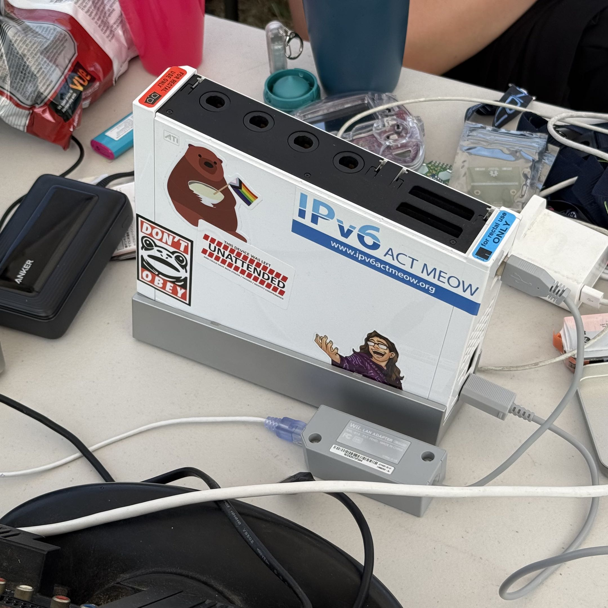

+++
title = 'This blog is hosted on a Nintendo Wii... in a field'
date = 2026-07-17T11:23:00Z
draft = false
summary = "Round 2"
tags = ['netbsd', 'shitpost']
+++

Back in 2024, I rescued a Wii from the tech swap shop at EMF Camp.

After spending a while under my TV playing [only the finest](https://www.youtube.com/watch?v=AkD-xBBTv2k) Wii games, I repurposed it last year to host this blog. You can read last year's post [here](/posts/2025-04-21-this-blog-is-hosted-on-a-nintendo-wii/).

This year, I brought it back to its EMF Camp homeland to continue its job hosting the site:

Assuming you're reading this between Friday 17th July and Sunday 19th July 2026, this Wii on a picnic table in a field served the page you're reading now.

If you're at EMF Camp, you can come visit the Wii at the Ministry of Chaos village.

Feel free to add to the stickerbombing that's already happened to it!

It will probably break and be very unstable, and I'm vaguely expecting it to melt in this weather. If it's broken, please call Ministry of Chaos on CHAOS (24267) and I'll try and fix it. If it's on fire, please call  0118 999 881 999 119 7253.

